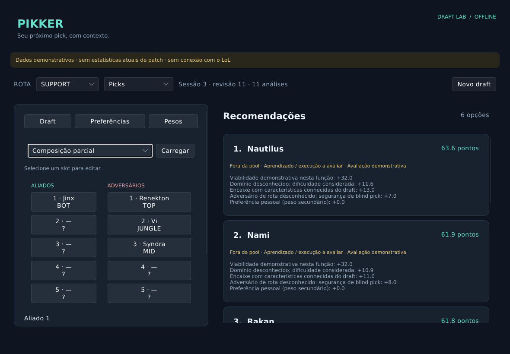

# Pikker

A lightweight League of Legends champion-select companion built with Rust and Slint.
Draft-aware recommendations for TOP, JUNGLE, MID, BOT and SUPPORT, without an LLM,
embedded browser, background service or automatic picks.



## Download and run

Windows x64 packages are published through [GitHub Releases](https://github.com/Muriel-Gasparini/pikker/releases).
Download `pikker-windows-x64.zip` and `SHA256SUMS.txt`, verify the ZIP's SHA-256,
extract the entire archive and open `pikker.exe`. No Rust, Python or Node installation is needed.
The release pipeline is being prepared; source availability is not a completed Windows release.

The executable is initially unsigned. Windows reputation warnings may appear;
verify the source and checksum rather than disabling security protections.
See the [Portuguese Windows guide](docs/windows-quickstart.txt).

## How it works

- Open Pikker before entering the queue. Loading progress shows catalog/statistics preparation.
- Recent statistical cache is reused; failures retain usable previous data with freshness/coverage warnings.
- Choose your role, preferences and proficiency. Recommendations can include champions outside your pool.
- Automatic mode reads the local League Client API (LCU); manual mode lets you simulate without LoL.
- Draft changes recompute recommendations locally, without OP.GG requests on each pick or ban.
- Runes and summoner spells are suggestions only, available when cached data provides them.

Pikker never selects champions, applies runes, writes to Riot's client or installs an autostart service.
Closing the window stops the application; a request in flight can take approximately 16 seconds to finish.

## Experimental status

This beta does not guarantee winning or climbing ranks. Scores are heuristics, not personal win probabilities.
Statistics come from OP.GG; champion labels come from Riot Data Dragon. Unknown patch, region or
population remains unknown. Selecting an elo does not prove that every result covers that population.
Composition traits cover only a curated subset of the full champion catalog.

LCU is unsupported and can change without a major version bump. The pinned contract and synthetic tests
do not prove compatibility with the latest ranked session. A real Windows/LoL session has not been validated.
ARAM is not implemented. Linux [resource measurements](docs/performance.md) do not prove Windows performance or FPS impact.

Riot product registration/audit and OP.GG data-use/cache/quotas must be resolved before treating
public binary distribution as cleared. No official approval or unrestricted rights to game data are claimed.

## Privacy and configuration

Preferences, requested elo and statistical cache stay in `profile.json`, `settings.json` and `meta.json` locally.
Windows uses `%LOCALAPPDATA%\Pikker`; Linux uses `$XDG_DATA_HOME/pikker` or `~/.local/share/pikker`.
`PIKKER_DATA_DIR` selects an isolated directory; `PIKKER_LCU_LOCKFILE` optionally supplies a client lockfile path.
There is no telemetry. External requests fetch public catalog/meta data; LCU credentials stay local and redacted.
Player names, PUUIDs, chat and raw ranked captures are not persisted or shipped. Never upload credentials or personal data in issues.

## Development

Install Rust 1.94.0. Linux needs X11/Wayland development dependencies (Ubuntu:
`libxcb-shape0-dev`, `libxcb-xfixes0-dev`, `libxkbcommon-dev`, `libwayland-dev`, `pkg-config`).
Windows uses MSVC with Visual Studio Build Tools and the Windows SDK.

```sh
cargo test --locked --no-default-features
cargo test --locked --features gui-test
cargo clippy --locked --all-targets --features gui-test -- -D warnings
cargo fmt --check
cargo run --locked --release
```

Normal tests use synthetic fixtures and local TLS servers, not a live client or OP.GG queries.
Two ignored native tests require a graphical session. See [contributing](CONTRIBUTING.md),
[architecture](docs/architecture.md), [fixture provenance](tests/support/lcu/README.md) and [security reporting](SECURITY.md).

## License and acknowledgements

Original code is [MIT licensed](LICENSE). Third-party code, assets and statistics retain their own rights.
Slint uses its Royalty-free 2.0 license; AboutSlint is accessible in the application's About screen.
The package includes [third-party notices](THIRD_PARTY_NOTICES.txt).

Pikker isn't endorsed by Riot Games and doesn't reflect the views or opinions of Riot Games or anyone officially involved in producing or managing Riot Games properties. Riot Games, and all associated properties are trademarks or registered trademarks of Riot Games, Inc.
